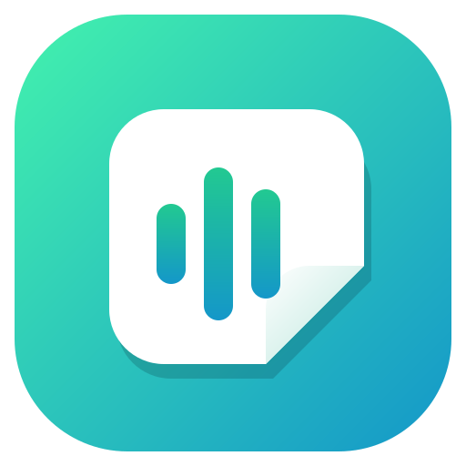
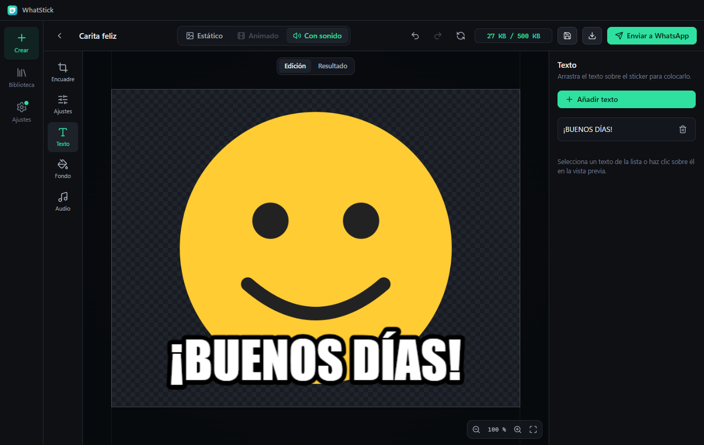

<div align="center">
  
  <h1>WhatStick</h1>
  <p><b>Crea stickers estáticos, animados y con sonido para WhatsApp desde Windows y envíalos a tu chat con un clic.</b></p>
</div>



## Qué hace

- **Tres tipos de sticker:** estático, animado sin sonido y **animado con sonido** (los nuevos stickers que suenan al tocarlos).
- **Importa casi todo:** MP4, MKV, MOV, WebM, GIF, PNG, JPG, WebP (también animados). Puedes arrastrar archivos, elegir varios, pegar una imagen con <kbd>Ctrl</kbd>+<kbd>V</kbd> o pegar un enlace de vídeo o de un sonido de [MyInstants](https://www.myinstants.com).
- **Editor visual:**
  - recorte arrastrando las esquinas, libre o cuadrado, con cuadrícula, zoom y desplazamiento;
  - giro, volteo y elección entre encajar la imagen entera o rellenar el cuadrado;
  - fondo transparente o de color, y eliminación de fondos lisos;
  - brillo, contraste y saturación;
  - textos con contorno;
  - deshacer y rehacer.
- **Línea de tiempo:**
  - miniaturas reales y forma de onda;
  - recorte con asas o con tiempos exactos;
  - avance fotograma a fotograma;
  - velocidad y repetición en bucle.
- **Audio:** el original o el de otro archivo, que puede ser un audio o el sonido de un vídeo: desde el disco, desde un enlace (MyInstants, YouTube, TikTok…) o desde un vídeo que ya hayas importado. Una foto con el sonido de un vídeo es un sticker con sonido en dos clics. Incluye volumen, opción de igualar el volumen y un limitador contra la distorsión, y la imagen y el sonido van sincronizados.
- **Siempre dentro de los límites de WhatsApp:** 512×512, 100 KB los estáticos y 500 KB los animados, hasta 10 segundos. Calcula con una muestra del vídeo la mejor combinación de fluidez y calidad que cabe, y muestra el peso real antes de enviar.
- **Envío a WhatsApp:** vincula WhatStick como un dispositivo más (con un QR, como WhatsApp Web) y envía el sticker a tu chat contigo mismo («Tú»). Desde allí lo guardas en favoritos o lo reenvías.
- **Biblioteca:**
  - miniaturas que se animan al pasar el ratón y que se pueden escuchar;
  - búsqueda, filtros y favoritos;
  - renombrar, exportar y eliminar (a la papelera);
  - volver a editar cualquier sticker sin empezar de cero.

## Descarga e instalación

Descarga la última versión desde [Releases](https://github.com/Dreex14/WhatStick/releases):

- `WhatStick-x.y.z-instalador.exe`: instalador para Windows 10 y 11 (64 bits).
- `WhatStick-x.y.z-portable.exe`: versión portable, sin instalación.

Como el ejecutable no está firmado, Windows SmartScreen puede mostrar el aviso «Windows protegió su PC». Pulsa **Más información → Ejecutar de todas formas**.

## Cómo se usa

1. **Crear:** arrastra un archivo, pégalo o pega un enlace.
2. Elige el tipo arriba: **Estático**, **Animado** o **Con sonido**.
3. Encuadra, recorta el fragmento en la línea de tiempo y añade texto si quieres. En **Resultado** ves el sticker real y su peso.
4. Pulsa **Guardar** para tenerlo en la biblioteca y **Enviar a WhatsApp** para mandarlo a tu chat.
5. La primera vez, ve a **Ajustes → WhatsApp → Vincular WhatsApp** y escanea el QR desde el móvil: *Ajustes → Dispositivos vinculados → Vincular un dispositivo*.

Atajos: <kbd>Espacio</kbd> reproduce, <kbd>←</kbd>/<kbd>→</kbd> avanzan un fotograma, <kbd>Ctrl</kbd>+<kbd>Z</kbd>/<kbd>Y</kbd> deshacen y rehacen, y <kbd>Ctrl</kbd>+<kbd>S</kbd> guarda.

## Cómo funciona el envío a WhatsApp (y sus límites)

WhatsApp no ofrece ninguna forma oficial de enviar stickers desde el PC. WhatStick usa [Baileys](https://github.com/WhiskeySockets/Baileys), una implementación libre del protocolo multidispositivo de WhatsApp Web:

- Es una **integración no oficial**: puede dejar de funcionar si WhatsApp cambia su protocolo. El editor, la biblioteca y la exportación seguirán funcionando. Todo el código de WhatsApp está aislado en `integration/whatsapp/`.
- WhatStick aparece como un dispositivo vinculado más y puedes cerrarlo desde el móvil o con **Desvincular**.
- **Sesión cifrada:** la sesión se guarda en tu PC (`%APPDATA%\WhatStick\whatsapp`) cifrada con tu usuario de Windows (DPAPI), así que copiada a otro equipo o leída por otro usuario no sirve.
- **Conectado solo cuando hace falta:** por defecto se conecta al enviar un sticker y se desconecta a los 3 minutos sin uso (en Ajustes puedes dejarlo siempre conectado).
- **No pide contraseñas, no guarda ni muestra tus mensajes y no envía nada sin tu confirmación.** El código solo puede enviar a tu propio chat.
- Un sticker con sonido son dos archivos en un mismo mensaje: el WebP y un audio Opus, enlazados por el SHA-256 del audio. Por eso no se puede crear arrastrando un archivo a WhatsApp.
- Probado con WhatsApp para Android y WhatsApp Escritorio para Windows (noviembre de 2026).
- No hay forma de añadir un sticker directamente a favoritos: se hace desde el chat, manteniéndolo pulsado.
- Debajo del sticker, WhatsApp muestra «paquete · autor». Ambos se eligen en **Ajustes → Stickers** (por defecto, «Mis stickers · WhatStick»).

## Privacidad

Todo el procesamiento de imagen, vídeo y audio es local. Sin cuentas, sin anuncios, sin telemetría y sin servidores propios. Las únicas conexiones son con WhatsApp, con los enlaces que tú pegues y, si importas un enlace de vídeo por primera vez, con GitHub para descargar yt-dlp.

## Compilar desde el código

Requisitos: [Node.js](https://nodejs.org) 20 o superior.

Instala las dependencias:

```powershell
npm install
```

Abre la aplicación:

```powershell
npm start
```

Ejecuta las pruebas del motor multimedia:

```powershell
npm test
```

Genera el instalador y la versión portable en `dist/`:

```powershell
npm run dist
```

Estructura:
- `engine/`: motor multimedia (importación, edición, compresión y validación).
- `integration/whatsapp/`: envío a WhatsApp.
- `app/`: interfaz.
- `docs/fase1-viabilidad.md`: el estudio del formato de los stickers con sonido.

## Créditos

WhatStick reúne herramientas existentes:

- **[FFmpeg](https://ffmpeg.org)** hace la conversión multimedia.
- **[sharp](https://sharp.pixelplumbing.com)** trata las imágenes.
- **[Baileys](https://github.com/WhiskeySockets/Baileys)** habla con WhatsApp.
- **[yt-dlp](https://github.com/yt-dlp/yt-dlp)** descarga los enlaces.
- **[Electron](https://www.electronjs.org)** da la ventana.

Lo que añade WhatStick es el editor, el ajuste automático a los límites de WhatsApp, la sincronización del audio, el envío de stickers con sonido y la biblioteca.

Ideas y código reutilizados de [SonoSticker](https://github.com/ThatChip2000/SonoSticker), [StikSound](https://github.com/SilverFeit/StikSound) y [whatsapp-sound-sticker-bot](https://github.com/DavidRamirez206/whatsapp-sound-sticker-bot), y documentación de [WA-audio-stickers](https://github.com/Shirtep/WA-audio-stickers). Iconos de [Lucide](https://lucide.dev). Las licencias de cada componente están en [TERCEROS.md](TERCEROS.md).

## Licencia

El código de WhatStick tiene licencia [MIT](LICENSE). Las dependencias mantienen la suya; el FFmpeg incluido es GPL-3.0 y se ejecuta como programa independiente.

**Exención de responsabilidad:** WhatStick es un proyecto personal y no oficial, sin relación con WhatsApp ni con Meta. El autor no se hace responsable del uso del programa ni del contenido que se obtenga, cree o envíe con él. Usa solo contenido que tengas permiso para usar.

---

Hecho por **[Dreex](https://github.com/Dreex14)**.
